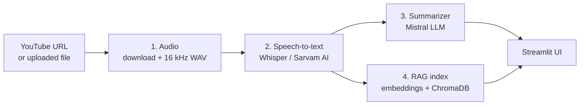

# 🎬 AI Video & Meeting Assistant

Paste a YouTube link or upload a recording, and the app will:

1. **Transcribe** the speech (English with Whisper, Hinglish with Sarvam AI)
2. **Summarize** it and extract **action items, key decisions and open questions** (Mistral LLM)
3. Let you **chat with the video** - answers come only from what was actually said (RAG)

---

## 🏗️ How it works



| Step | File | What it does |
|---|---|---|
| 1. Audio | `backend/audio_processor.py` | Downloads only the audio from YouTube (yt-dlp), converts it to 16 kHz mono WAV (the format speech models expect) and splits long recordings into 10-minute chunks. |
| 2. Speech-to-text | `backend/transcriber.py` | **English:** OpenAI Whisper runs locally - free and private. **Hinglish:** audio is cut into 25-second pieces and sent to Sarvam AI in parallel, which transcribes and translates to English. |
| 3. Summarizer | `backend/summarizer.py` | Mistral LLM writes the title, summary, action items, decisions and questions. Long transcripts use **Map-Reduce**: summarize each part in parallel, then combine. |
| 4. RAG chat | `backend/rag_engine.py` | Transcript is split into 500-character chunks, embedded with `all-MiniLM-L6-v2` and stored in ChromaDB. For a question, the 4 most similar chunks are given to the LLM, which must answer only from them. |
| Orchestration | `backend/pipeline.py` | Runs steps 1 → 2, then runs step 3's five LLM calls and step 4 **at the same time**. |
| LLM client | `backend/llm_service.py` | Creates the Mistral client from `.env` settings. |
| PDF report | `backend/report.py` | Converts the results (the LLM writes Markdown) to HTML and lays them out as a PDF with fpdf2, using a bundled Unicode font. |
| UI | `app.py` + `styles.py` | Streamlit page: inputs on the left, results and chat on the right. |

---

## 📂 Project structure

```text
AI-video-Assistant/
├── app.py                  # Streamlit web UI  (streamlit run app.py)
├── styles.py               # UI styling (CSS)
├── backend/
│   ├── pipeline.py         # runs all steps in order
│   ├── audio_processor.py  # 1. YouTube / file  -> WAV chunks
│   ├── transcriber.py      # 2. WAV chunks       -> transcript
│   ├── summarizer.py       # 3. transcript       -> title, summary, insights
│   ├── rag_engine.py       # 4. transcript       -> Q&A chat
│   ├── report.py           # results             -> downloadable PDF report
│   └── llm_service.py      # Mistral LLM client
├── assets/fonts/           # DejaVu Sans font used in the PDF (Unicode support)
├── tests/
│   └── test_backend.py     # offline unit tests
├── downloaded_videos/      # downloaded YouTube audio (cache)
├── data/downloads/         # uploads and converted WAV files
├── .streamlit/config.toml  # Streamlit settings (500 MB upload limit)
├── requirements.txt
└── .env.example            # copy to .env and add API keys
```

---

## 🚀 Run it locally

**Prerequisites:** Python 3.10+, [FFmpeg](https://ffmpeg.org/download.html), and Node.js or Deno (YouTube needs a JavaScript runtime).

```bash
pip install -r requirements.txt
cp .env.example .env          # then add MISTRAL_API_KEY and SARVAM_API_KEY
streamlit run app.py
```

Open http://localhost:8501.

**Tests** (no API keys needed):

```bash
python -m unittest discover tests
```

---

## 🌐 Deploying on a VPS (YouTube without cookies)

> How the bot-detection problem was solved, step by step: [YOUTUBE_BOT_DETECTION.md](YOUTUBE_BOT_DETECTION.md)

YouTube often answers server IPs with *"Sign in to confirm you're not a bot"*. The app handles this without cookies:

- **Client fallback** - if one YouTube player client is blocked, the download is retried with others (`tv`, `android_vr`, `web_safari`, `web_embedded`).
- **PO-token provider** - the `bgutil-ytdlp-pot-provider` plugin creates the token YouTube's bot check asks for. It needs a small token server:

```bash
# 1. System packages, app dependencies, JavaScript runtime
sudo apt-get install -y python3-venv ffmpeg curl
python3 -m venv .venv
.venv/bin/pip install -r requirements.txt
curl -fsSL https://deno.land/install.sh | sh

# 2. PO-token server (bind to 127.0.0.1 only - never expose it publicly)
curl -fsSL https://get.docker.com | sh
sudo docker run --name bgutil-provider -d --init --restart unless-stopped \
  -p 127.0.0.1:4416:4416 brainicism/bgutil-ytdlp-pot-provider:2.0.2

# 3. Run the app (use a systemd service in production)
.venv/bin/streamlit run app.py --server.port 8501
```

Keep yt-dlp updated, since YouTube changes often: `.venv/bin/pip install -U "yt-dlp[default]"`.

If YouTube blocks the server's IP completely, set `YOUTUBE_PROXY` in `.env` (for example a free Cloudflare WARP proxy: `socks5://127.0.0.1:40000`), or download the video yourself and use **Upload file**.

---

## 💡 Design decisions (interview talking points)

| Question | Answer |
|---|---|
| **Why separate `backend/` from the UI?** | The AI logic has no Streamlit code, so the same backend could be reused by a CLI or a REST API (FastAPI) without changes. |
| **Why Whisper + Sarvam?** | Whisper is excellent for English and runs locally at no cost. Sarvam is specialized for Indian languages and code-mixed Hinglish, and translates directly to English. |
| **Why 16 kHz mono WAV?** | It is the input format speech models are trained on; converting once avoids repeated decoding. |
| **Why chunk the audio?** | Long recordings would use too much memory; Sarvam also accepts only ~30 s per request, so pieces are sent in parallel (31 pieces for a 13-minute video take ~7 s). |
| **Why Map-Reduce summarization?** | A 1-2 hour transcript doesn't fit well in one prompt. Summarizing parts in parallel and then combining keeps quality even across long meetings. |
| **Why run LLM calls in parallel?** | Title, summary, action items, decisions, questions and RAG indexing don't depend on each other, so a thread pool runs them together. |
| **Why RAG instead of sending the whole transcript?** | Only the 4 most relevant chunks go to the LLM - cheaper and faster, and the prompt forces answers grounded in the transcript, which reduces hallucination. |
| **Why an in-memory vector store per analysis?** | Every analysis gets its own ChromaDB collection, so two users on the server never see each other's data, and nothing piles up on disk. |
| **Why local embeddings (`all-MiniLM-L6-v2`)?** | Small, fast on CPU and free - no API cost for indexing. |
