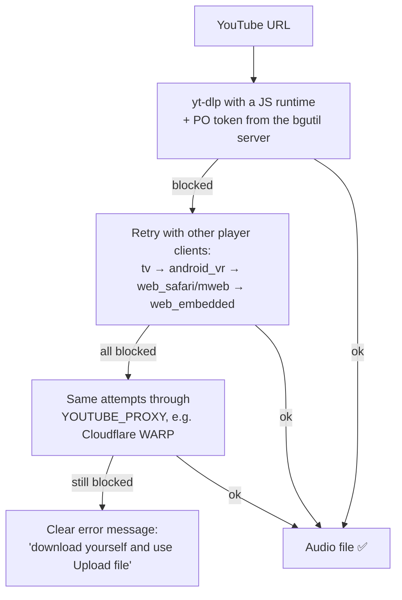

# Solving YouTube Bot Detection on a VPS (without cookies)

## The problem

On a laptop, YouTube downloads worked. On the VPS, the same code failed:

| Error | Meaning |
|---|---|
| `Sign in to confirm you're not a bot` | YouTube's bot check. It shows up mostly for **datacenter IPs** (VPS, cloud servers), which YouTube trusts less than home internet connections. |
| `Requested format is not available` | YouTube returned no downloadable streams, because yt-dlp couldn't solve YouTube's JavaScript challenge. |
| `HTTP Error 403: Forbidden` | YouTube refused the media stream for that request. |

## The first approach: cookies (and why it was dropped)

The usual workaround is to export a logged-in browser's YouTube cookies and give them to yt-dlp. It worked for a while, but caused a stream of new problems:

- **They expire.** YouTube changes session cookies regularly, so they had to be re-exported by hand again and again.
- **yt-dlp rewrites the cookie file** after every download. If the file was read-only, the download crashed. If two users downloaded at once, the file could be corrupted.
- **Security risk.** The cookie file is a logged-in Google session. The admin page used to manage the cookies was reachable by anyone and displayed them.
- **Manual maintenance.** Someone has to keep logging in, exporting and uploading cookies.

The goal became: **no cookies at all**.

## The solution: several layers of protection

### 1. JavaScript runtime: solve YouTube's challenge
YouTube protects its stream URLs with a JavaScript puzzle. Without a JavaScript engine, yt-dlp gets no usable formats, which caused the "Requested format is not available" error.

- **Fix:** the app detects **Deno** or **Node.js** automatically and passes it to yt-dlp. If the `yt-dlp-ejs` solver package is missing, it is fetched automatically.
- The original code also forced YouTube's `web` client, which always needs this challenge to be solved. That setting was removed.

### 2. PO tokens: pass the bot check without logging in
YouTube's bot check asks the client for a **Proof-of-Origin (PO) token**, a token a real browser generates with YouTube's own "BotGuard" script. Cookies were only ever a stand-in for this proof.

- **Fix:** the [`bgutil-ytdlp-pot-provider`](https://github.com/Brainicism/bgutil-ytdlp-pot-provider) plugin (the method the yt-dlp project recommends) generates real PO tokens.
- It has two parts:
  - a **Python plugin** (in `requirements.txt`), which yt-dlp loads automatically;
  - a small **token server** in Docker, reachable only from the server itself (`127.0.0.1:4416`).
- Whenever YouTube asks for proof, yt-dlp gets a token from the local server. No account is involved.

### 3. Player client fallback: if one door is closed, try another
YouTube serves video through several "player clients" (web, TV, Android VR, mobile web, embedded player), and each is checked differently. A request blocked on one client often succeeds on another.

- **Fix:** `download_youtube_audio()` tries the clients one after another until one works.
- It stops immediately for private or removed videos, where retrying can't help.
- **Tested:** with the first two attempts forced to fail with the bot error, the third client hit a *real* HTTP 403 from YouTube, and the fourth downloaded the file successfully.

### 4. Proxy fallback: a different IP if the server's IP is blocked
If YouTube blocks the VPS's IP outright, nothing in code can fix that from the same IP.

- **Fix:** the optional `YOUTUBE_PROXY` setting routes **only YouTube traffic** through another IP.
- A free option is **Cloudflare WARP** in *proxy mode*. Only traffic sent to that proxy goes through Cloudflare; SSH and the rest of the server are unaffected.

### 5. Last resort: Upload file
Uploading a file never touches YouTube, so it always works. The error message tells users about this option.

### Bonus: smaller, faster downloads
Only the **audio** track is downloaded (transcription doesn't need video): about **12 MB instead of about 1.2 GB** for a 13-minute 4K video. Fewer and smaller requests also mean less load for YouTube to flag.

## Server setup

The setup steps are in the README ("Deploying on a VPS"): install **Deno**, install the Python packages (including the PO-token plugin), start the **PO-token server** in Docker, and optionally set `YOUTUBE_PROXY`.

Problems found while setting up the real VPS:
- **Ubuntu 25.10 ships Python 3.13**, which removed the `audioop` module the audio library needs. Added `audioop-lts` for Python 3.13+.
- **Cloudflare has no WARP package for Ubuntu 25.10 yet.** Use the Ubuntu 24.04 (`noble`) package from Cloudflare's repository instead.
- A setup error (for example, the app failing to import) can look like a download failure. Always check the real error message before assuming YouTube is blocking the server.

## Where it is in the code

| What | Where |
|---|---|
| JS runtime detection, client fallback, proxy | `backend/audio_processor.py` → `_ytdlp_options()`, `download_youtube_audio()`, `PLAYER_CLIENTS` |
| PO-token plugin | `requirements.txt` → `bgutil-ytdlp-pot-provider` |
| Server setup steps | `README.md` → "Deploying on a VPS" |

## Limits (honest)

- **No guarantee.** YouTube changes its defenses often. The approach is layered so that when one layer stops working, the next one takes over.
- **Keep yt-dlp updated** (`pip install -U "yt-dlp[default]"`). Most breakages are fixed upstream within days.
- **If YouTube also blocks WARP's IPs**, the remaining options are a paid residential proxy in `YOUTUBE_PROXY`, or using Upload file.
- **Status:** each layer was tested locally, including a real 403 handled by the fallback. Final confirmation on the VPS is still pending.

## In one sentence (for an interview)

> Instead of borrowing a logged-in user's cookies, which expire, break and are a security risk, the app proves it is a legitimate client the same way a browser does: it solves YouTube's JavaScript challenge, generates a Proof-of-Origin token through a local token server, and falls back across YouTube's player clients and finally to a different IP through a proxy.